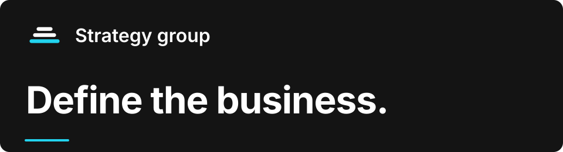

<p align="center">
  <picture>
    <source media="(max-width: 640px)" srcset=".github/readme/cover-mobile.svg">
    
  </picture>
</p>

<h1 align="center">A business definition you can act from.</h1>

<p align="center">
  Four specialist workers develop your venture's connected strategy.<br>
  You bring the purpose and material. Your own AI does the specialist work. You settle the decisions.
</p>

<p align="center">
  <a href="#start">Start here</a> &nbsp; / &nbsp;
  <a href="#four-specialists-one-connected-definition">Meet the workers</a> &nbsp; / &nbsp;
  <a href="#your-decisions-stay-with-you">How it works</a>
</p>

---

## The questions a business needs to answer

What are you building? Whom does it serve? Why would they choose it? What do you offer, how does it earn, and what advances next?

The Strategy group puts those professional questions and their relationships in front of your AI. Its workers develop connected choices, ask for what is missing and bring the decisions to you. When a decision changes, the documents built on it are checked for agreement.

## Four specialists, one connected definition

| Specialist | The work it develops |
| --- | --- |
| [Venture strategist](venture-strategist/PROFILE.md) | Venture definition, objectives, bets, focus plan and strategy review. |
| [Market strategist](market-strategist/PROFILE.md) | Segments, target segments and opportunities. |
| [Positioning strategist](positioning-strategist/PROFILE.md) | Differentiation, positioning and category. |
| [Business model designer](business-model-designer/PROFILE.md) | Revenue model, offer catalogue and price book. |

## Start

You need a coding agent and Python 3.11 or later. From your venture repository, clone the group into the path its commands expect:

```sh
git clone https://github.com/LeanOS-Technologies/strategy.git workers/strategy
```

Open your agent at your venture repository root and ask:

> Read workers/strategy/AGENTS.md. Establish the initial direction for my venture "my-venture". Here is what I know: ...

Bring your purpose, customers and offer, however rough. The workers ask for the rest. You can also begin with one focused request, such as defining the venture or revising an offer.

<details>
<summary><strong>More prompt examples</strong></summary>

Adapt the business details and attach the material each prompt refers to.

**Choose a customer focus**

> For my scheduling-software venture, compare independent clinics and multi-site practices as initial customers. Use the attached interviews, product notes and operating constraints to develop a target recommendation and explain the trade-offs.

**Develop positioning**

> Our buyers compare us with spreadsheets and general booking tools. Using our product notes and customer conversations, develop a positioning proposal. Distinguish capabilities we have from those we are still planning.

**Develop offers and pricing**

> We have accepted target customers and positioning. Use those decisions and the attached cost and delivery constraints to propose our offers and pricing. Show your assumptions and the decisions I need to settle.

</details>

> [!TIP]
> **Delete this README after cloning.** It is the GitHub marketing page, not part of the Strategy model. You can also delete `.github/readme/`, which contains only this page's artwork. Your agent starts at [AGENTS.md](AGENTS.md). Keep [LICENSE](LICENSE).

## Your decisions stay with you

| Step | What happens |
| --- | --- |
| **01 · Bring the brief** | Supply your direction, current material and the question you need answered. |
| **02 · Develop the work** | The relevant specialists develop their documents and expose missing inputs and decisions. |
| **03 · Check the connections** | Programs check structure, references and arithmetic; specialists check the meaning across affected documents. |
| **04 · Accept the change** | You read the candidate set and decide. Only accepted changes become current. |

Documents are Markdown files in your repository. Initial candidates live under `venture/my-venture/strategy/candidate/`. Related work can use the accepted decisions in later sessions.

<details>
<summary><strong>Check the documents</strong></summary>

From your venture repository root:

```sh
python3 workers/strategy/.group/tools/check.py venture/my-venture/strategy
```

The checker establishes its declared structural, reference, quantity and attribution properties. It does not replace specialist judgment or your acceptance.

</details>

<details>
<summary><strong>Look inside the group</strong></summary>

- [AGENTS.md](AGENTS.md) — the group entry point, members and routing.
- [.group/contracts/](.group/contracts/) — the document contracts and their relationships.
- [.group/tools/](.group/tools/) — shared checks and views.
- Each worker's `AGENTS.md`, `PROFILE.md`, knowledge and `.claude/skills/` — its specialist methods.

The group prepares strategy and recommendations. Your business direction, acceptance and external commitments remain yours.

</details>

---

<p align="center">
  <strong>The whole group. Free under MIT.</strong><br>
  Use it, study it, change it and share it. Your strategy documents are yours.<br>
  <a href="LICENSE">Read the licence</a>.<br><br>
  Built by <a href="https://www.leanos.tech/">LeanOS</a> · Operating with AI
</p>
